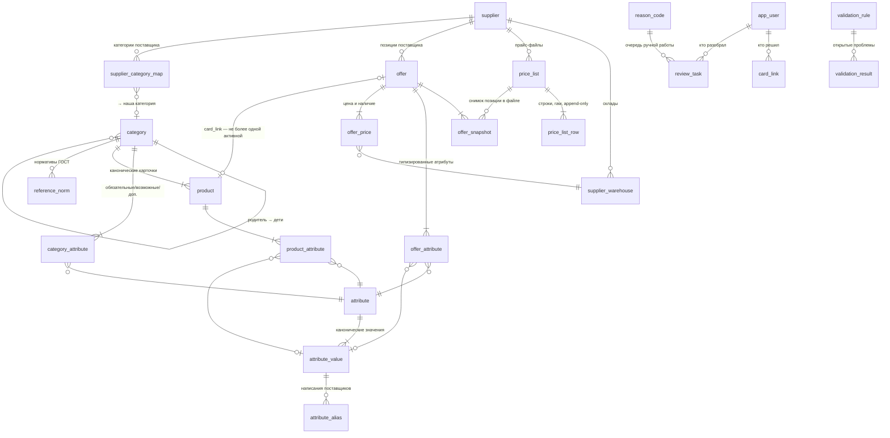

# Схема базы данных: слои, таблицы, связи, ограничения

СУБД — PostgreSQL 15+ (обоснование выбора — в конце). Полный исполняемый DDL: `db/001_schema.sql`, справочники: `db/002_seed.sql`, представления: `db/003_views.sql`. Все объекты — в схеме `onmi`.

## 0. Пять принципов, из которых выросла схема

1. **Слои.** Сырые данные поставщика (`price_list_row`), нормализованные позиции (`offer*`) и канонический каталог (`product*`) — три независимых слоя. Никогда не смешиваем: у прайса и каталога разные источники правды, разные темпы изменений и разные владельцы качества.
2. **Идентичность товара — данные, а не эвристика.** «Тот же товар» = категория + канонические значения обязательных атрибутов + единица + состояние. Для этого предвычисляются хэши идентичности (`product.identity_hash`, `offer.natural_key_hash`) с уникальными индексами.
3. **История вместо перезаписи.** Всё, что влияет на витрину (цены, привязки, алиасы, решения), живёт интервалами `valid_from`/`valid_to` и журналируется (`audit_log`). «Одна активная запись» обеспечивается частичным уникальным индексом `WHERE valid_to IS NULL`, а не дисциплиной кода.
4. **Справочники вместо хардкода.** Единицы, атрибуты, значения, алиасы, категории, причины, правила валидации, политики видимости — таблицы. Новая ниша или новое написание поставщика — INSERT, а не релиз.
5. **Запрет на молчаливую потерю.** Каждая строка прайса заканчивается одним из четырёх исходов: привязка / задача человеку / «вид не возим» (осознанное решение) / технический отказ загрузки. Баланс сходится в `pipeline_run.stats`.

## 1. ER-диаграмма (основные связи)



## 2. Перечень таблиц (31)

### Слой 1. Справочники — `reference` (9 таблиц)

| Таблица | Назначение | Ключевые ограничения |
|---|---|---|
| `unit` | Единицы измерения: т, кг, м, м², м³, штука | `code` UNIQUE |
| `unit_conversion` | Разрешённые конверсии и коэффициенты (т↔кг = 1000) | PK `(from_unit_id, to_unit_id)` |
| `attribute` | Словарь атрибутов во всех нишах: `diameter`, `wall_thickness`, `grade`, `coating`, `length_class`, `strength_class`, `standard`, `brand`, `memory`, `color`… У каждого — тип (`enum`/`number`/`text`), единица, правило нормализации | `code` UNIQUE |
| `attribute_value` | Канонические значения enum-атрибутов: `coating=zn` («Оцинкованный»), `length_class=6m/12m/nd`, `grade=09Г2С`… | UNIQUE `(attribute_id, code)` |
| `attribute_alias` | Как поставщики пишут значения: «оцинк.», «Zn», «цинк 100 г/м²» → `coating=zn`; «н/д» у Металлсервиса → `length_class=nd`. Статусы `candidate/approved/rejected` — новые написания сначала кандидаты | UNIQUE `(attribute_id, alias_raw)` |
| `category` | Дерево категорий (`path` материализованный: `metall/truby/vgp`) | `parent_id` FK→self, `path` UNIQUE, UNIQUE `(parent_id, slug)` |
| `category_attribute` | Атрибутный состав категории: `required / optional / additional` — прямо три уровня из текущего процесса онмни | PK `(category_id, attribute_id)` |
| `condition_policy` | Политика видимости состояний «НН»/«уценка»/«некондиция»: `show / hide / separate_card`. Решение бизнеса, меняется без релиза | PK `condition_code` |
| `reason_code` | Причины исходов: 16 кодов из текущего прайса (`ambiguous_source_grade`, `canonical_length_or_coil_form_missing_in_source`, …) + новые (`new_alias_value`, `multiple_cards_match`…) с флагом «требует человека» | `code` UNIQUE |

### Слой 2. Поставщики и сырьё — `source` (4 таблицы)

| Таблица | Назначение | Ключевые ограничения |
|---|---|---|
| `supplier` | Поставщик («Металлсервис», дальше — другие) | `code` UNIQUE |
| `supplier_warehouse` | Склады поставщика (в тесте — 24: Курск, Самара, …) | UNIQUE `(supplier_id, external_name)` |
| `price_list` | Загруженный файл: имя, SHA-256, дата получения, статус, счётчики строк. Повторная загрузка того же файла даёт `status=duplicate` и no-op | **UNIQUE `(supplier_id, file_sha256)`** — контрольный случай 12 |
| `price_list_row` | Строка файла «как есть»: склад, категория поставщика, название, характеристики-сырец, единица, цены, дата прайса, ссылка, `raw_json`. Append-only: UPDATE/DELETE запрещены ролью `etl_raw` | UNIQUE `(price_list_id, row_number)` |

### Слой 3. Нормализованные позиции — `offer` (4 таблицы)

| Таблица | Назначение | Ключевые ограничения |
|---|---|---|
| `offer` | Позиция поставщика как устойчивая сущность: natural key = нормализованный набор атрибутов, состояние (`normal/nn/utsenka/nekonditsiya`), жизненный цикл (`active/retired`) | **UNIQUE `(supplier_id, natural_key_hash)`** — повторная загрузка не плодит дубли |
| `offer_snapshot` | Как позиция выглядела в конкретном прайсе: сырое название, сырые атрибуты, `changed_fields` (diff с прошлым снапшотом) — контрольный случай 11 | UNIQUE `(offer_id, price_list_id)` |
| `offer_attribute` | Типизированные атрибуты позиции: `value_number` / `attribute_value_id` / `value_text` по типу атрибута, источник (`column/title/spec_url`), уверенность парсинга | PK `(offer_id, attribute_id)`; CHECK-триггер «заполнено ровно одно значение по типу» |
| `offer_price` | Цена и наличие: позиция × склад × интервал действия, цена с/без НДС, единица цены, дата прайса-источника, ссылка на исходную строку | **partial UNIQUE `(offer_id, warehouse_id) WHERE valid_to IS NULL`** — одна активная цена на позицию и склад; CHECK цены > 0 |

### Слой 4. Канонический каталог — `catalog` (4 таблицы)

| Таблица | Назначение | Ключевые ограничения |
|---|---|---|
| `product` | Карточка сайта: `product_id` переносится из текущего каталога (адреса страниц не меняются), `slug` UNIQUE, `legacy_code` (артикул ONMI) для переноса существующих привязок, единица продажи, вес/объём, `work_status` (`todo/ready/published/archived`), происхождение (`migration/manual/offer_derived`), предвычисленный `identity_hash` | **UNIQUE `slug`**; **partial UNIQUE `(category_id, identity_hash)`** — два одинаковых товара в категории невозможны |
| `product_attribute` | Атрибуты карточки в тех же типах, что у офферов + источник и отметка верификации | **Составной FK-замок** (см. §3.1): атрибут вне списка категории вставить нельзя |
| `product_media` | Изображения (перенос `image_url/image_status` из текущего каталога) | FK `product_id` |
| `reference_norm` | Нормативы: швеллер 30П → 31,8 кг/м (ГОСТ 8240), допуск ±10%. Ловит «7,05 кг» | FK `(category_id)`, `(attribute_id)` |

### Слой 5. Связка прайс ↔ каталог — `match` (2 таблицы)

| Таблица | Назначение | Ключевые ограничения |
|---|---|---|
| `supplier_category_map` | Категория поставщика («Металлопрокат / ТРУБЫ ЭЛЕКТРОСВАРНЫЕ») → наша категория, статус `mapped/needs_review/ignored`. «Нет такого вида товара» становится осознанным решением с автором, а не потерей | PK `(supplier_id, supplier_category_raw)` |
| `card_link` | Привязка оффер ↔ карточка: метод (`rules_exact/rules_disambiguated/manual/llm_suggest/legacy_import`), уверенность, кто и когда решил, `rule_trace` (какие правила сработали), интервал действия | **partial UNIQUE `offer_id WHERE status='active'`** — активная привязка ровно одна; UNIQUE `(offer_id, product_id)` — история той же пары не плодится; триггер совместимости (§3.3) |

### Слой 6. Качество и операции — `ops` (8 таблиц)

| Таблица | Назначение | Ключевые ограничения |
|---|---|---|
| `app_user` | Акторы: аналитики, админы, системные задания | `login` UNIQUE |
| `review_task` | Очередь ручной работы: предмет (`offer/alias/product/category_map/price_conflict`), причина из `reason_code`, контекст в `payload` (кандидаты-карточки, diff, недостающие атрибуты), тип разрешения и его результат — что именно сделал человек | partial UNIQUE открытых задач по `(subject_type, subject_id, reason_code)` — дублей задач нет |
| `validation_rule` | Каталог правил качества: `name_attr_dn_mismatch`, `weight_norm_violation`, `unit_weight_sanity`, `price_outlier_vs_card_median`, `stale_price`… с severity `block/warn/info` | `code` UNIQUE |
| `validation_result` | Открытые проблемы по сущностям: карточка, оффер, привязка, цена. `block`-проблемы останавливают публикацию | partial UNIQUE `(rule_id, entity_type, entity_id) WHERE status='open'` |
| `golden_set` | Эталонная разметка (позиция → заведомо верная карточка) для регрессионного теста правил: любое изменение правил прогоняется по эталону до выката | UNIQUE `offer_id` |
| `pipeline_run` | Каждый прогон конвейера: тип, версия правил (`ruleset_version` = git-SHA репозитория правил), статусы, счётчики исходов в `stats` jsonb (привязано / в ревью / отказано / игнор), ошибка | FK `price_list_id` где применимо |
| `audit_log` | Журнал изменений критичных таблиц (привязки, алиасы, состав атрибутов категории, политики): до/после, кто, когда. Триггерный, не зависит от дисциплины кода | индекс по `(entity_type, entity_id)` |
| `config` | Параметры конвейера: `freshness_days` (срок жизни цены, по умолчанию 60), `auto_link_min_confidence` и др. | PK `config_key` |

## 3. Как таблицы мапятся между собой (и почему ошибок не возникает)

### 3.1. Справочник замыкает атрибуты на категорию: составной FK-замок

Три внешних ключа вместе делают «чужой атрибут» физически невозможным:

```
product              (product_id, category_id)   UNIQUE
product_attribute    (product_id, category_id) → product(product_id, category_id)        -- FK-1
product_attribute    (category_id, attribute_id) → category_attribute(category_id, attribute_id)  -- FK-2
```

Вставить в карточку атрибут, не объявленный для её категории (`category_attribute`), СУБД не позволит — не нужно проверять это в коде и нельзя обойти «срочным фикс-скриптом». `offer_attribute` связан с теми же `attribute` / `attribute_value`, поэтому сравнение оффера с карточкой идёт в одном словаре, а не «русские атрибуты каталога против английских ключей прайса» — это устраняет сегодняшнее расхождение («Размер»/«Марка»/«Тип проката» против `size`/`grade`/`source_field_1`).

### 3.2. Идентичность: один и тот же товар — по хэшу, а не по тексту

```
identity = SHA-256( category_id
                  + сортированный список: attribute_code '=' canonical_value
                    для всех атрибутов категории с role = 'required' )
```

- `product.identity_hash` пересчитывается триггером при изменении атрибутов карточки; уникальность внутри категории → **один товар не распадается на карточки** (дубль не вставится), а **разные товары не склеиваются** (различие хотя бы в одном обязательном атрибуте даёт другой хэш). «Оцинкованная против чёрной» различаются обязательным `coating` — ошибка «37 труб на чужих карточках» становится невозможной.
- `offer.natural_key_hash` — тот же алгоритм от атрибутов позиции (+ единица + состояние). Один поставщик не сможет завести две одинаковые позиции, а повторная загрузка найдёт существующую.
- Канонизация значений перед хэшированием: числа — к десятичной точке и без хвостовых нулей («0,5» = «0.5» = «.5»); enum — через `attribute_alias` к `attribute_value.code`; марки — нормализация кириллица↔латиница («40Х13» = «40X13»); размеры — к миллиметрам. Поэтому «Труба ВГП 20х2,8 оцинк. 6 м» и «Труба в/г оц. Ду20 ст. 2,8 L=6м» дают одинаковый natural key.

### 3.3. Привязка защищена триггером совместимости

Активировать `card_link` можно, только если: (а) у карточки заполнены все обязательные атрибуты категории (`identity_hash IS NOT NULL`), (б) хэш оффера, посчитанный по обязательным атрибутам категории этой карточки, равен хэшу карточки, (в) единицы совместимы (совпадают или конверсия объявлена и разрешена категорией), (г) у карточки нет открытых `block`-проблем валидации, (д) состояние оффера разрешено политикой. Иначе — исключение на уровне БД: неверная привязка не пройдёт ни через какой путь записи, включая ручной.

### 3.4. Поток данных по слоям

```
файл → price_list (sha256, дедуп) → price_list_row (raw, навсегда)
     → нормализация: offer (natural key, идемпотентно) + offer_attribute (словари/алиасы)
                     + offer_snapshot (diff) + offer_price (интервалы по складам)
     → матчинг: supplier_category_map → кандидаты-карточки → card_link (триггер §3.3)
     → публикация: v_site_price (активные привязки × активные цены × свежесть × политика состояний)
     → обратная связь: review_task → разрешения (новый алиас / обязательный атрибут / новая карточка)
                       → справочники → следующий прогон умнее
```

### 3.5. Инварианты: сегодняшние ошибки → механизм, который их исключает

| Ошибка из ТЗ / данных | Механизм | Таблица/индекс |
|---|---|---|
| Разные товары на одной карточке | обязательные атрибуты в идентичности + триггер совместимости | `product.identity_hash`, `card_link`-триггер |
| Один товар в нескольких карточках | UNIQUE идентичности в категории | partial UNIQUE `(category_id, identity_hash)` |
| Код поставщика на двух страницах | одна активная привязка на оффер | partial UNIQUE `offer_id WHERE status='active'` |
| Несколько цен на карточку и склад | одна активная цена на позицию+склад; у позиции — одна активная привязка | partial UNIQUE `(offer_id, warehouse_id) WHERE active` |
| Устаревшие цены на сайте | срок жизни цены + интервалы действия | `config.freshness_days`, `v_site_price` |
| Карточка противоречит сама себе | правила-блокировщики: название↔атрибуты, нормативы веса, санити единицы | `validation_rule/result`, `reference_norm` |
| Атрибут не из категории / словаря | составной FK-замок, значения только из канонических | §3.1, `attribute_value` |
| Привязка без объяснения | NOT NULL метод/решающий + трассировка правил + аудит | `card_link`, `audit_log` |
| Дубли при повторной загрузке | хэш файла + natural key позиции | `price_list`, `offer` |
| Позиция потерялась молча | каждый исход фиксируется, баланс сходится в отчёте прогона | `review_task`, `pipeline_run.stats` |
| Правила поменяли — сломали проверенное | версия правил в каждом прогоне + регресс на эталоне | `pipeline_run.ruleset_version`, `golden_set` |

## 4. Обоснование ключевых решений

- **EAV для атрибутов, а не колонки.** Ниши меняются (металл → электроника): колонки потребуют ALTER TABLE и кода на каждую нишу. Обязательность и типы при этом не «размазаны»: `category_attribute` + триггеры держат схему жёстко. Опасение «EAV медленный» здесь не критично: 5–8 атрибутов на сущность, десятки тысяч строк, а для матчинга сравнение идёт по предвычисленному хэшу, а не по джойнам EAV.
- **PostgreSQL.** Дано по умолчанию; при этом нужны именно его возможности: partial unique indexes (все инварианты «ровно одна активная запись»), интервалы и `tstzrange`-логика, `jsonb` для payload/трассировок, транзакционная целостность DDL для миграций. Отдельного поиска/векторов на старте не требуется: матчинг детерминированный по атрибутам; если позже добавим нечёткий поиск кандидатов — pgvector остаётся в той же СУБД.
- **UUID PK.** Текущие `product_id` из каталога переносятся как есть (адреса страниц не меняются — требование миграции), генерация идентификаторов не зависит от последовательностей БД (загрузка файлов параллелится).
- **Интервалы вместо флагов `is_active`.** Флаг не хранит историю и не защищает от двух «активных». Частичный уникальный индекс по `valid_to IS NULL` даёт и то и другое.
- **Raw-слой append-only.** Перепрогон истории при взятии категории в работу (случай 13), разбор инцидентов «что было в файле на самом деле», защита от тихих правок. Полный разбор пайплайна — `docs/03-маппинг.md`.
